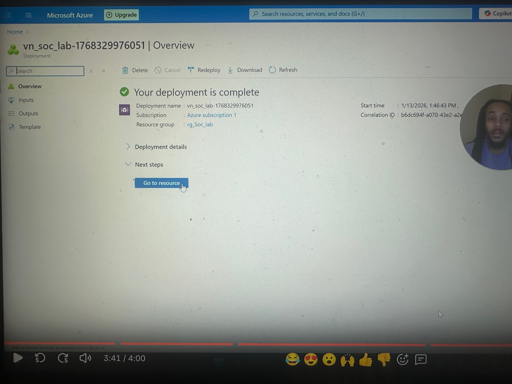
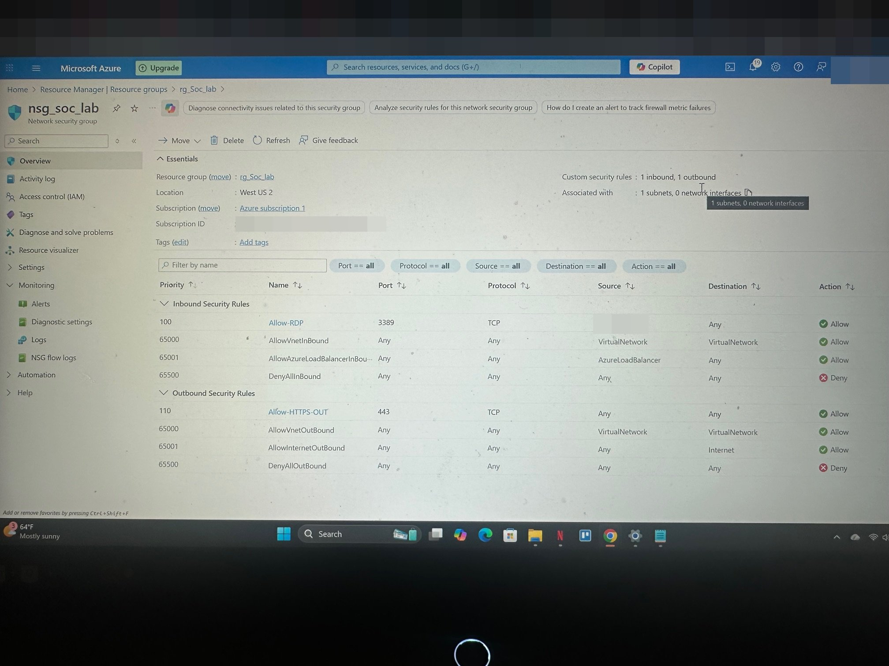
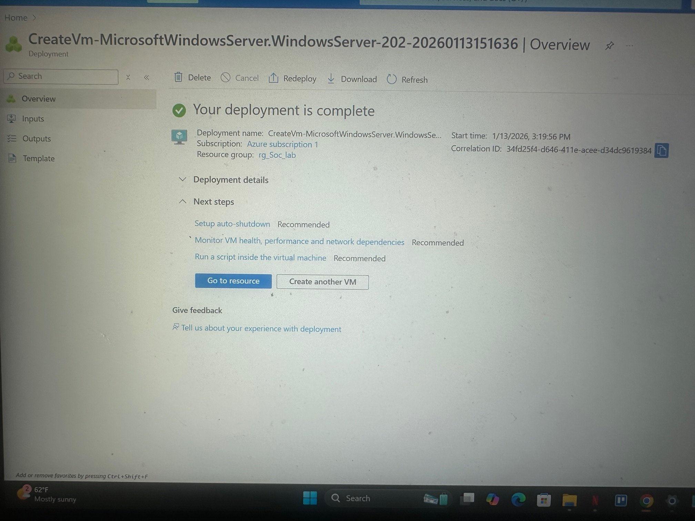
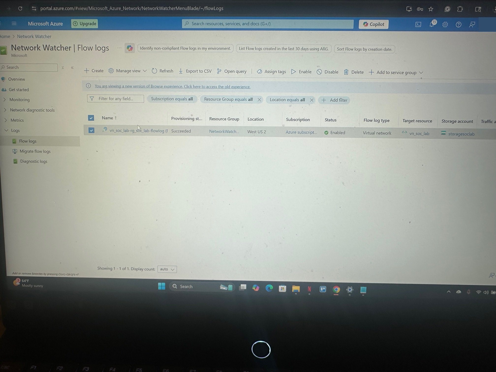

# Azure SOC Home Lab: VNet, NSG, VM & Flow Logs

A hands-on Azure lab that sets up the network foundation of a Security Operations Center (SOC) environment: a segmented virtual network, tightly scoped NSG rules, a Windows VM, and VNet flow logs for traffic visibility.

**Status:** Paused. The network, NSG, VM and flow logs are built.

## What it demonstrates

- Azure Virtual Network and subnet design
- Network Security Group rules for inbound and outbound traffic control
- Least-privilege access: RDP allowed only from my own IP, all other inbound traffic denied
- VNet flow logging to a storage account for network traffic visibility

## Architecture

| Resource | Name | Details |
|---|---|---|
| Resource group | `rg_Soc_lab` | All resources in one region (West US 2) |
| Virtual network | `vn_soc_lab` | Subnet `Subnet-Soc` |
| Network security group | `nsg_soc_lab` | Attached to `Subnet-Soc` |
| Virtual machine | `VM_soc_lab` | Windows Server; no public inbound ports outside the NSG |
| Flow logs | VNet flow log on `vn_soc_lab` | Stored in a storage account, 30-day retention |

### NSG rules

| Direction | Rule | Port | Source → Destination | Action |
|---|---|---|---|---|
| Inbound | Allow-RDP | 3389/TCP | My IP only → Any | Allow |
| Inbound | Default deny | Any | Any → Any | Deny |
| Outbound | Allow-HTTPS-OUT | 443/TCP | Any → Any | Allow |

## Build steps

1. **Resource group:** created `rg_Soc_lab`, keeping every resource in the same region.
2. **Virtual network:** created `vn_soc_lab` with the `Subnet-Soc` subnet.
3. **NSG:** allowed RDP from my IP only, allowed HTTPS outbound, and attached the NSG to `Subnet-Soc`.
4. **Virtual machine:** deployed `VM_soc_lab` into `Subnet-Soc` with no public inbound ports beyond the NSG rules.
5. **Flow logs:** in Network Watcher, enabled VNet flow logs for `vn_soc_lab`, sent to a new storage account with 30-day retention.

## Screenshots

| | |
|---|---|
| **Virtual network deployment**  | **NSG rules**  |
| **VM deployment**  | **VNet flow logs enabled**  |

## Video walkthroughs (Loom)

- [Virtual network setup](https://www.loom.com/share/bd32b9e5df3f4c74b363e4e692ec654d)
- [NSG rule configuration](https://www.loom.com/share/14da1838e5f64eadb8a36b5b842c27ec)
- [Virtual machine setup](https://www.loom.com/share/edecb32b5c1a46bb8032e9e7d6c276bc)
- [Setting up flow logs](https://www.loom.com/share/a9a0047cdcc540a9a1237383a727a4f9)

## Next steps

- Connect the flow logs to Log Analytics / Traffic Analytics and onboard Microsoft Sentinel to build detections on top of the traffic data.
